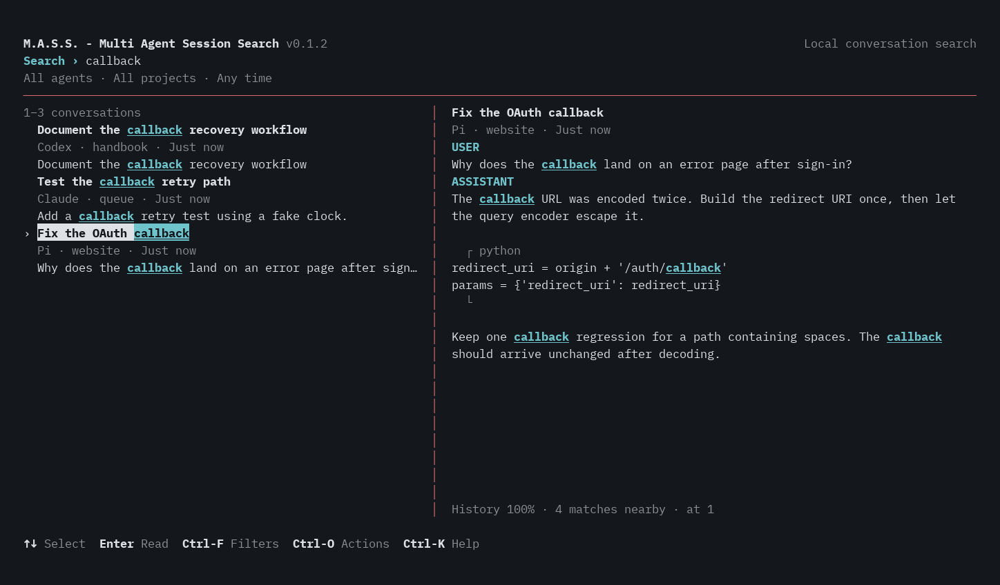

# M.A.S.S. — Multi Agent Session Search

Find the conversation where you worked something out. Read the relevant passage.

MASS is a local, keyboard-first conversation finder for **Pi, Claude Code, and Codex**. One search field, a result list, and a readable conversation preview—not a dashboard or another agent harness.

**Public development preview — no official releases yet.** We are building toward a first release; interfaces and cache formats may still change. The supported initial target is x86_64 Linux/glibc. Search and reading work offline; there are no model calls, accounts, telemetry, or background services.



*Real terminal output using invented conversations, not private history. See `docs/PREVIEW.md` to reproduce it.*

## Build and try

Requires Git, a current stable Rust toolchain, a C compiler, and a host linker. Latest local validation used Rust 1.99.0; this is not a minimum-version guarantee. SQLite/FTS5 and zstd are bundled; Python and fzf are not runtime dependencies.

Clone the source:

git clone https://github.com/commonfire-foundation/mass.git

Then build:

```sh
cd mass
cargo build --locked --release
```

**Try invented conversations first** (Python 3 required only for the demo):

```sh
python3 scripts/demo.py
```

The demo uses disposable project-local sources, configuration, and cache. It disables native reopening and clipboard helpers, never reads your histories, and cleans up when you quit. Try `callback`, press Enter to read, and Escape to return or quit. For a noninteractive check, use `python3 scripts/demo.py --check`.

To search your own histories instead:

```sh
./target/release/mass
```

First run asks before building the index. Later launches use the existing cache; **Ctrl-L** refreshes it explicitly. An initial scan can take a few minutes for a large history.

Existing Rust schema-1 caches need one explicit `mass index` (or Ctrl-L) to upgrade to schema 2. The upgrade is transactional and preserves cached history; subsequent refresh reparses available sources with the corrected importer. Read-only commands never migrate a cache. Older binaries cannot read schema 2.

**In a source checkout, use `./target/release/mass`, not `./mass`.** The latter remains the preserved Bash/fzf prototype; its separate instructions are in `docs/PROTOTYPE.md`. There is no automatic migration between their caches or configurations.

For a locally prepared **binary archive**, verify its adjacent `.sha256` file with `sha256sum -c`, extract the archive, and run `./mass` inside the extracted directory. That file is the Rust executable, not the source checkout's prototype. No binary archives have been published.

Optional user installation from source:

```sh
cargo install --locked --path .
```

This installs into Cargo's binary directory, normally `~/.cargo/bin`. Ensure it is on your PATH. Uninstall with `cargo uninstall mass`; configuration and cached conversations are retained until you remove them explicitly.

## Use it

| Key | Action |
| --- | --- |
| Type | Search conversation text and metadata |
| Up / Down | Select a result or scroll the reader |
| Enter | Read at the matching passage |
| Esc | Back, cancel, or quit |
| Ctrl-F | Filter by agent, project, or activity date |
| Ctrl-K | Keyboard help |
| Ctrl-O | Session actions: export, copy, source location, reopen |
| Ctrl-D | Session details |
| Ctrl-L | Refresh the index; clear fields inside the filter dialog |
| PageDown / PageUp | Next / previous result page |
| /, then n / N | Find within a conversation and navigate matches |

Wide terminals show a side preview; narrower terminals use the full reader. `NO_COLOR=1` retains non-color focus cues. Optional clipboard actions use an existing `wl-copy` (Wayland) or `xclip` (X11); MASS never installs a helper or uses OSC52.

The CLI uses the same search engine:

```sh
mass index
mass search 'redirect callback'
mass search '"redirect callback"' --agent pi --json
mass search 'migration' --project /absolute/path/to/project --since 2026-01-01
mass show SESSION_REF
mass status
```

Unquoted words match token prefixes; quoted phrases match phrases. Quote colon-containing literals such as `"Error: timeout"` or `"std::vector"`; `project:"path with spaces"` remains a filter. Weaker fuzzy matches apply to titles/project paths, not transcript bodies. Search is lexical, not semantic. Results are grouped by session; an empty query shows recent sessions. `mass search --help` lists filters and cursor pagination options.

## Use a found session

Press **Ctrl-O** on a result or in the reader. The menu can:

- Export the conversation or current message as **Markdown or JSON**.
- Copy the search excerpt, complete current message, session reference, or source path.
- Show the original transcript's location without opening or changing it.
- Review reopening in the original harness. **Ctrl-R** also opens this review directly; **C** copies an available reviewed command, and **Y** deliberately launches it.

Exports require an explicit destination and never overwrite existing files. Metadata paths are omitted by default; Tab toggles them in the export sheet. **Conversation text can still contain paths and secrets.** Exports contain indexed conversation text, not a native/restorable harness backup.

```sh
mass export SESSION_REF --format markdown --output conversation.md
mass export SESSION_REF --format json --message MESSAGE_REF --output message.json
```

Add `--include-paths` only when you want source/cwd metadata included. A message reference can point to any chunk; export reassembles the complete message without duplicated chunk overlap. Markdown exports and clipboard text retain tabs and line endings; terminal escapes and bidi controls are removed. JSON preserves the original text. Relative destinations are relative to MASS's working directory. The destination directory must already exist.

Native reopening stays experimental/default-off. The transcript identity, current configuration permission, and reviewed command are checked again after confirmation. A copied shell command is only a snapshot and bypasses later MASS rechecks when run elsewhere. See `docs/HARNESS-COMPATIBILITY.md` for version-specific offline checks and remaining limits.

## Sources and privacy

Default roots:

- Pi: `~/.pi/agent/sessions`
- Claude Code: `~/.claude/projects`
- Codex: `~/.codex/sessions` and `~/.codex/archived_sessions`

For other roots, configure `~/.config/mass/config.toml`; see `docs/RUST.md` for the complete format. Explicit source configuration replaces the defaults. Agent-specific environment overrides are not automatically imported into Rust source discovery.

The default cache is `~/.cache/mass/index.sqlite3`. Standard XDG configuration/cache overrides and explicit `--config` / `--db` paths are supported.

**The cache contains plaintext conversation text, which may include secrets.** Newly created Unix database files are owner-readable/writable only. Keep the cache out of shared directories and inappropriate backups. Removing it does not securely erase SQLite sidecars, filesystem snapshots, or backups.

Discovery, indexing, search, and reading never launch agents or modify transcripts. Only configured transcript roots are scanned; symlinked files/directories are skipped. Missing stores retain cached history instead of treating an offline mount as deletion.

## Boundaries

- Pi message/summary and export records, Claude message/child records, and Codex rollout/event/compaction records are supported, including compressed Codex `.jsonl.zst` files. Not every historical or future agent format is guaranteed.
- This searches conversation text and summaries—not tool output, reasoning, images, or every byte of an agent log.
- Malformed records and records exceeding the 16 MiB retained text/metadata limit are reported through `mass status`. Large discarded image payloads do not consume that retained-data budget.
- The reader is intentionally simple, not a full Markdown renderer. CLI `show` streams chunks, which can contain overlap.
- Search has a two-second execution budget. An overly broad query can fail explicitly; narrow it rather than interpreting failure as zero matches.
- **Resume is experimental and disabled by default.** Guarded offline session-loading/return checks pass for the three tested harness versions; normal authenticated configurations remain unverified. `mass resume REF --dry-run` inspects the guarded plan without launching anything. Do not enable `resume = true` unless you deliberately accept the agent's own hooks, permissions, configuration, and possible network activity. Archives, exports, children, and ambiguous histories can be read-only regardless of configuration.

## Local packaging and validation

```sh
bash scripts/package.sh
cargo test --locked
python3 tests/rust_tui_pty.py
python3 tests/rust_cli_recovery.py
python3 tests/rust_package_smoke.py
```

Packaging requires Python 3 for dependency notices. It creates a host archive and checksum under `dist/`; it does not install or publish anything. Archives include usage documentation, MIT license, dependency license notices, and the host dynamic-library requirements. They are not universally static binaries.

`docs/VALIDATION.md` records synthetic tests, approved real-corpus checks, measured performance, and limits of the evidence. `docs/LOCAL-RELEASE.md` is the lean release checklist. More detailed command/configuration behavior is in `docs/RUST.md`.

Changes accumulate in `CHANGELOG.md` under **Unreleased**. Versions are bumped when cutting a release, not after each edit; see `VERSIONING.md`.

## Building in public

Small fixes, synthetic format examples, and focused usability reports are welcome. Read `CONTRIBUTING.md` for development checks and safe bug reports. Do **not** attach real conversations, caches, credentials, or unredacted diagnostic output. Suspected vulnerabilities belong in private reports; see `SECURITY.md`.

Issues and the remaining release checklist:
https://github.com/commonfire-foundation/mass/issues

There is no official binary download or crates.io release yet. Development source availability is not a compatibility or support guarantee. `DESIGN.md` includes future goals; `docs/RUST.md` describes implemented behavior. Older implementation notes under `docs/history/` are historical, not current acceptance checklists.

## License

MIT. See `LICENSE`. Dependencies retain their respective licenses.
